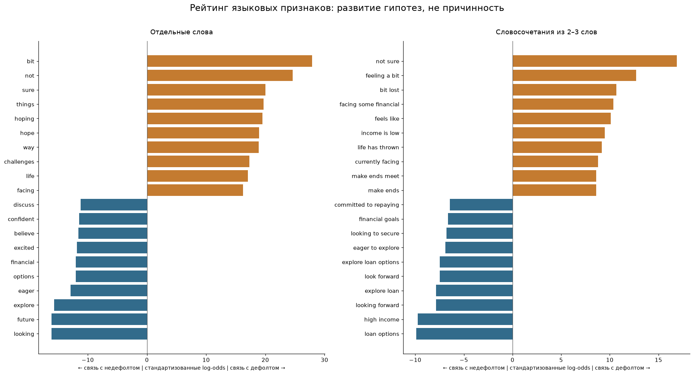

# Mortgage Default · ML & Bank Profit

Предсказание ипотечного дефолта с автоматическими текстовыми признаками и отдельной оценкой денежного результата кредитной политики. Один интегрированный ноутбук для Kaggle, Google Colab и локального Jupyter.

[Открыть ноутбук](Mortgage_Default.ipynb) · [Открыть в Colab](https://colab.research.google.com/github/Pernya/mortgage-default-ml/blob/main/Mortgage_Default.ipynb) · [Подготовить данные](data/README.md)


## Содержание проекта

- Аудит пропусков, распределений и связи признаков с дефолтом.
- Карты слов и словосочетаний, ранжирование выражений по связи с классом.
- Автоматическое извлечение текстовых признаков из полей `речь` и `сбор` через TF-IDF; ручной словарь не требуется.
- Сравнение текстовых, табличных и комбинированных моделей; CatBoost, линейные модели, стекинг и смеси.
- OOF-прогнозы, подбор параметров и порога F1, диагностика train / validation и расширенная проверка через вложенную CV.
- Проверки формата submission: `ID,дефолт`, бинарные ответы и соответствие тестовым ID.
- Бизнес-дополнение: выдача всем, отказ по F1 и решение по ожидаемому денежному результату; калибровка, сценарии платежей и bootstrap.



## Что подтверждено сохранённым запуском

Это публикация предоставленного ноутбука с его результатами. Основная часть выполнена частично; расширенные эксперименты исходных ячеек 48–77 не имеют сохранённых результатов. Бизнес-раздел выполнен отдельно и не означает, что весь расширенный поиск завершён.

В сохранённом бизнес-разделе для **Stack all d5** при фиксированном пороге **0,385** F1 на контрольной выборке составляет около **0,9868**. Этот holdout уже изучался ранее: результат относится к повторной офлайн-диагностике, а не к новому независимому тесту или подтверждённому месту в Kaggle.

Для аннуитетного сценария на **710 заявках с известными суммой и сроком**:

| Политика | Номинальный результат за весь срок кредитов |
|---|---:|
| Выдать всем | 274,17 млн |
| Отказывать по F1-порогу | 349,12 млн |
| Решение по ожидаемому денежному результату | 348,32 млн |

F1-политика в этом сохранённом сценарии дала примерно **+27,34%** к выдаче всем. Денежная политика не превзошла F1-политику; остальные сценарии и неопределённость показаны в ноутбуке.

Суммы выражены в денежных единицах датасета. Это **номинальный результат за полный срок**, без стоимости фондирования, операционных затрат, дисконтирования и возврата залога. Пропуски суммы/срока исключены из денежной оценки: 402 из 1 112 контрольных заявок. Эти допущения ограничивают перенос результатов на реальный банк. Слова и словосочетания показывают статистическую связь, а не причину дефолта.

## Запуск

Нужны `train.csv`, `test_feat.csv`, `submission_example.csv`. Ожидаемые размеры: 5 557 обучающих и 1 390 тестовых строк. Датасеты в репозиторий не включены.

| Среда | Подготовка | Основной результат |
|---|---|---|
| Kaggle | Импортировать `.ipynb`, подключить данные соревнования, при необходимости разрешить установку зависимостей | `/kaggle/working/submission.csv` |
| Colab | Открыть ссылку выше, загрузить три CSV при запросе или задать `DATA_DIR` | `/content/mortgage_outputs/submission.csv` |
| Локально | CSV рядом с ноутбуком или в `data/`, выбрать Python 3.10+ kernel | `mortgage_outputs/submission.csv` |

```bash
python -m venv .venv
source .venv/bin/activate  # Windows: .venv\Scripts\activate
python -m pip install -r requirements.txt
jupyter lab Mortgage_Default.ipynb
```

Настройки `DATA_DIR`, `OUTPUT_DIR`, `AUTO_INSTALL`, подключение Google Drive и скачивание submission находятся в начале ноутбука. Установка библиотек выполняется в текущий kernel. Полный поиск содержит много обучений и может быть длительным; для нового воспроизводимого расчёта выполняйте ноутбук с начала в чистом kernel.

Бизнес-раздел №16 можно выполнить отдельно после установки зависимостей, указав `BM_TRAIN_PATH` или `BM_DATA_DIR`. Порог `BM_F1_THRESHOLD` задан явно и может отличаться от порога нового полного запуска.

## Статус публикации

Сохранены вычислительный код, аналитические графики и результаты. Убраны служебные метаданные и вывод с личными локальными путями. Исходный файл не изменён. `publication.json` содержит его SHA-256 и статус выполнения.

Проверены формат ноутбука и синтаксис всех code-ячеек, включая IPython-команды. **Полный Run All, новый submission и фактическое выполнение в Kaggle/Colab при публикации не проверялись.** Сохранённые результаты не подменяются результатами статической проверки.

```bash
python -m pip install -r requirements-validation.txt
python scripts/validate.py
```

Эта же проверка автоматически выполняется в GitHub Actions.
