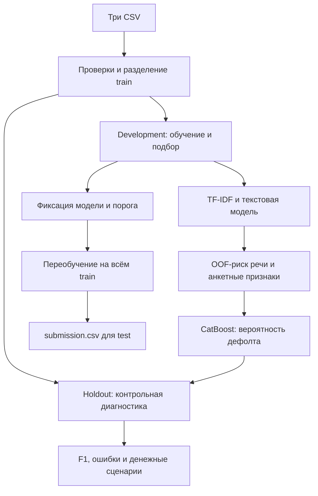

# Руководство по проекту ипотечного дефолта

[← Главная страница](../README.md) · [Основной ноутбук](../Mortgage_Default.ipynb) · [Открыть в Colab](https://colab.research.google.com/github/Pernya/mortgage-default-ml/blob/main/Mortgage_Default.ipynb)

Документация описывает текущий ноутбук и сохранённые результаты. Актуализирована 18 ноября 2026 года. Подготовка документации не включала новый полный цикл обучения.

## Содержание

1. [Назначение и статус](#purpose)
2. [Контракт входных данных](#data)
3. [Архитектура решения](#architecture)
4. [Автоматическая работа с текстом](#text)
5. [Модели и схема проверки](#validation)
6. [Денежная модель](#business)
7. [Установка и три способа запуска](#run)
8. [Настройки и функции](#settings)
9. [Результаты и проверки](#outputs)
10. [Типовые проблемы](#troubleshooting)

<a id="purpose"></a>

## 1. Назначение и статус

Задача — оценить вероятность дефолта клиента по анкете и текстовым полям. Для соревнования вероятность преобразуется в бинарный ответ с целью повысить F1. Для бизнес-анализа отдельно рассматривается правило выдачи, учитывающее сумму кредита и процентный доход.

Это исследовательский ноутбук, а не сервис принятия реальных кредитных решений. Временная доступность признаков, процесс получения речи и переносимость на новых банковских клиентов не подтверждены.

| Часть | Статус опубликованного файла |
|---|---|
| Аудит, карты слов, первичное сравнение | Есть сохранённые результаты |
| Расширенный вложенный поиск | Код есть; запуск и итоговые таблицы не завершены |
| Последующие диагностики и финальные submission | Требуют выполнения соответствующих ячеек |
| Самостоятельный бизнес-раздел №16 | Есть результаты отдельного запуска основной модели |
| Полный Run All в Kaggle/Colab/локально после редактирования | Не подтверждён |

В сохранённом бизнес-разделе F1 основного стека на ранее изучавшейся контрольной выборке составляет около **0,9868** при фиксированном пороге **0,385**. Это офлайн-результат, а не подтверждение позиции в рейтинге Kaggle.

<a id="data"></a>

## 2. Контракт входных данных

| Файл | Назначение | Размер по заданию |
|---|---|---:|
| `train.csv` | Обучающие признаки и `дефолт` | 5 557 строк |
| `test_feat.csv` | Признаки клиентов для отправки | 1 390 строк |
| `submission_example.csv` | Схема и идентификаторы ответа | 1 390 строк |

Одна строка — один клиент. `ID` должен быть непустым и уникальным; `дефолт` принимает 0 или 1. CSV читаются как строки с сохранением пустых полей, затем числовые поля преобразуются явно.

**Имена колонок, используемые кодом:**

```text
ID, дефолт, лимит_нарушен, пол, тип, цель, кредитоспособность,
другие_кредиты, бизнес, сумма, сбор, срок, амортизация,
только_процент, один_платеж, стоимость_имущества, работа,
тип_залога, тип_кредита, кредитный_рейтинг, возраст,
прямой_залог, речь
```

В test цель отсутствует. В бизнес-дополнении схема train проверяется строго: **5 557 × 23**, перечисленные имена, оба класса и отсутствие полных дубликатов признаков. Новый датасет другого размера потребует осознанной адаптации проверок.

| Группа | Поля и смысл |
|---|---|
| Числа | `сумма`, `срок`, `стоимость_имущества`, `кредитный_рейтинг` |
| Текст | `речь` — высказывание клиента; `сбор` — короткая фраза |
| Категории | Остальные анкетные поля после исключения ID и цели |
| Производные признаки | LTV, запас стоимости залога, количество пропусков, длина речи, порядок возрастной группы |

Названия исходного учебного описания могут отличаться от CSV. Ориентируйтесь на фактическую схему выше; не переименовывайте поля по смыслу без изменения кода. Датасеты не опубликованы: [как их разместить](../data/README.md).

<a id="architecture"></a>

## 3. Архитектура решения

Вся логика находится в одном `.ipynb`; внешнего Python-модуля для выполнения не нужно.



Переобучение на всём train допустимо для финального файла: контрольные строки тогда тоже входят в обучение. После этого оценка на этих же строках уже не является holdout-оценкой новой модели.

Бизнес-раздел №16 содержит собственные функции и переменные с префиксом `bm_`. Он повторно обучает основную конфигурацию и сохраняет деньги отдельно, не дожидаясь расширенного поиска.

<a id="text"></a>

## 4. Как модель сама находит слова и выражения

Здесь используются два разных вида анализа.

### Исследовательские карты

На development считаются слова и последовательности из 2–3 слов с поддержкой минимум **20 клиентов**. Повторение слова у одного клиента считается один раз. Частоты нормируются на размер класса, потому что клиентов с дефолтом и без него разное число.

Рейтинг `association_score` сравнивает шансы встретить выражение в двух классах, со сглаживанием 0,5 в таблице сопряжённости и поправкой на стандартную ошибку. Положительный знак связан с дефолтом, отрицательный — с недефолтом.

Размер слова на облаке — сила ассоциации. Частоту показывает отдельный график. `default_rate_given_term` — наблюдаемая доля дефолтов среди клиентов с выражением; это не самостоятельная вероятность дефолта нового клиента и не причинный эффект слова.

### Признаки для прогноза

`TfidfVectorizer.fit` строит словарь по обучающей части и рассчитывает веса слов. Основной текстовый уровень использует отдельные слова и пары слов; отдельные кандидаты исследуют триграммы и дополнительные автоматически отобранные фразы.

Логистическая регрессия учит коэффициенты этих признаков. Далее её прогноз риска речи поступает в CatBoost вместе с короткой фразой `сбор` и анкетой. Список выражений не задаётся вручную.

Варианты `AutomaticPhraseFeatures` выбирают выражения внутри обучающей части и создают дополнительные признаки для метамодели. Наличие этих вариантов в коде ещё не доказывает прирост F1: расширенная проверка должна быть выполнена.

Нормализация и построение построчных признаков отделены от обучаемых преобразований. Заполнение пропусков, масштабирование, словарь и категориальное кодирование обучаются в соответствующем training fold. Отрицания в моделирующем тексте сохраняются; `not big` нельзя без проверки превращать в `big`.

<a id="validation"></a>

## 5. Модели и схема проверки

### Разделение

Train делится со стратификацией на **4 445 development** и **1 112 holdout**, seed `20261017`. Первичные кандидаты сравниваются на одинаковых пяти фолдах development.

Сравниваются логистические модели по разным семействам признаков, CatBoost, правила объединения короткой фразы и речи, стекинг и смеси. Основная конфигурация фиксирована как `Stack all d5`.

**Стекинг:** внутри обучающей части четыре текстовые модели создают OOF-прогнозы речи для метамодели. На новом клиенте их прогнозы усредняются. Если бы CatBoost обучался на прогнозах текста по тем же строкам, которые видел текстовый классификатор, оценка могла бы стать искусственно хорошей.

### Расширенный поиск

В коде предусмотрены внешние 5 фолдов для оценки, внутренние 3 для выбора конфигурации и порога и внутренние 4 фолда текстового уровня. Это дорогой расчёт. Его незавершённый статус отмечен в ноутбуке; победитель полного поиска не объявляется по одному наличию кода.

### Метрики

| Метрика | Интерпретация |
|---|---|
| F1 | Баланс precision и recall для `дефолт=1`; размер кредита не учитывает |
| Precision | Доля фактических дефолтов среди предсказанных дефолтов |
| Recall | Доля обнаруженных дефолтов среди всех фактических |
| ROC AUC / Average Precision | Качество ранжирования рисков без одного фиксированного порога |
| Log loss / Brier score | Качество вероятностных прогнозов, а не только бинарных ответов |

`f1_05` использует порог 0,5. `f1_tuned_development` включает подбор порога на development OOF и потому является результатом подбора, а не независимой оценкой.

### Переобучение и неопределённость

Сравниваются train и validation, устойчивость по фолдам, кривые обучения и парный bootstrap разницы прогнозов. Малый разрыв train/validation не доказывает полного отсутствия переобучения. Интервалы bootstrap условны на уже обученных моделях и не охватывают весь разброс повторного подбора.

Holdout уже изучался ранее. Повторная оценка новых кандидатов на нём — диагностика, а не новый независимый тест. Офлайн-сравнение и абляции не являются A/B-тестом случайно назначенных банковских политик.

<a id="business"></a>

## 6. Денежная модель

Обозначения: `P` — сумма кредита, `n` — срок в месяцах, `r = 0.10 / 12` — месячная ставка, `p` — вероятность дефолта, `I` — процентный доход при исправной выплате.

Условие задания не задаёт полный график погашения, поэтому рассматриваются два сценария.

| Сценарий | Формулы | Допущение |
|---|---|---|
| Аннуитет | `A = P*r / (1-(1+r)^(-n))`; `I = n*A-P` | Равные ежемесячные платежи |
| Капитализация | `I = P*((1+r)^n-1)` | Без промежуточных выплат, проценты капитализируются |

При дефолте клиент не делает ни одной выплаты: выданный кредит даёт `-P`. Исправная выдача даёт `+I`. Отказ даёт `0`.

Ожидаемый результат выдачи:

```text
E[результат] = (1-p) × I − p × P
```

Экономическое правило одобряет при положительном результате, то есть `p < I/(I+P)`. Порог зависит от денежного сценария и срока. F1-политика использует фиксированный классификационный порог. В экономическом правиле применяются откалиброванные вероятности; sigmoid-калибратор обучается на development OOF.

Небольшой пример: если `P=100`, `I=20`, `p=0.10`, ожидаемый результат равен `0.9×20−0.1×100=8`. Это положительное значение в принятых допущениях; стоимость фондирования и прочие расходы здесь отсутствуют.

### Охват и сохранённый результат

Деньги считаются только для известных положительных суммы и срока: **710 из 1 112** контрольных заявок. Остальные **402** исключены из денежной оценки, а не записаны как банковские отказы. Все сравниваемые политики используют одинаковые строки; в знаменатель результата на заявку входят и одобренные, и отклонённые заявки.

| Аннуитетная политика | Результат за весь срок, млн денежных единиц |
|---|---:|
| Выдать всем | 274,17 |
| Порог F1 0,385 | 349,12 |
| Экономическое правило | 348,32 |

В этом сохранённом срезе экономическое правило не превзошло F1-политику. «Оракул» в расчёте заранее знает фактический дефолт и служит недостижимым ориентиром, а не доступным алгоритмом.

Не учтены фондирование, операционные затраты, дисконтирование, взыскание залога и досрочные выплаты. Валюта не подтверждена. Это номинальный итог полного срока, не годовая чистая прибыль. Денежные формулы дополнительно проверяются помесячным расчётом аннуитета и независимым суммированием.

<a id="run"></a>

## 7. Установка и запуск

### Локальный Jupyter

```bash
git clone https://github.com/Pernya/mortgage-default-ml.git
cd mortgage-default-ml
python -m venv .venv
```

Активируйте `.venv` через `source .venv/bin/activate` в macOS/Linux или `.venv\Scripts\Activate.ps1` в PowerShell, затем:

```bash
python -m pip install -r requirements.txt
jupyter lab Mortgage_Default.ipynb
```

Используйте Python 3.10+. Положите три CSV рядом с ноутбуком или в `data/`. Проверьте выбранный kernel. После этого выполните ноутбук с начала в чистом kernel; полный поиск может занять десятки минут или дольше.

### Google Colab

Откройте ссылку в начале руководства. Запустите с первой ячейки; при отсутствии данных загрузите три CSV по запросу либо задайте `DATA_DIR`. Google Drive подключается только по настройке. Основной результат при стандартном запуске — `/content/mortgage_outputs/submission.csv`.

### Kaggle

Создайте Notebook, импортируйте `.ipynb` и подключите данные соревнования. При необходимости установки отсутствующих библиотек включите интернет. Каталог `/kaggle/input` доступен только для чтения; результаты пишутся в `/kaggle/working`. После полного выполнения используйте предусмотренную соревнованием отправку ноутбука **Submit to competition**. Код сам ничего не отправляет.

### Только бизнес-раздел

Установите зависимости, перейдите к **разделу 16**, задайте полный `BM_TRAIN_PATH` и при желании `BM_OUTPUT_DIR`. Выполните все ячейки этого раздела сверху вниз. Расширенный поиск и тестовые CSV для этого маршрута не нужны.

Если основная настройка уже выполнялась, бизнес-результаты по умолчанию появятся внутри `OUT/business_metric_appendix/`. При отдельном запуске — в `business_metric_appendix/` текущей папки, а на Kaggle — в рабочей папке. Явный `BM_OUTPUT_DIR` устраняет неоднозначность.

<a id="settings"></a>

## 8. Настройки и функции

| Настройка | По умолчанию | Назначение |
|---|---|---|
| `DATA_DIR`, `OUTPUT_DIR` | `None` | Автоматический поиск входов и выбор папки результатов |
| `AUTO_INSTALL` | `True` | Установка совместимых зависимостей в текущий kernel |
| `UPLOAD_IF_MISSING` | `True` | Предложение загрузить CSV в Colab |
| `MOUNT_GOOGLE_DRIVE` | `False` | Необязательное подключение Drive |
| `DOWNLOAD_SUBMISSION` | `True` | Скачивание результата в Colab после проверки |
| `BM_TRAIN_PATH`, `BM_DATA_DIR` | `None` | Вход самостоятельного бизнес-раздела |
| `BM_OUTPUT_DIR` | `None` | Выход самостоятельного бизнес-раздела |
| `BM_F1_THRESHOLD` | `0.385` | Явно фиксированный порог сравниваемой F1-политики |
| `BM_ANNUAL_RATE` | `0.10` | Номинальная годовая ставка сценария |
| `BM_BOOTSTRAP_REPEATS` | `2000` | Число bootstrap-повторов денежного расчёта |

`BM_F1_THRESHOLD` не синхронизируется автоматически с порогом нового полного поиска: это сознательно отдельная настройка. Если меняете её, называйте новый расчёт отдельным экспериментом.

| Компонент | Роль |
|---|---|
| `detect_environment`, `resolve_data_paths`, `choose_output_dir` | Подготовка среды и путей |
| `prepare`, `make_lr`, `make_cb` | Признаки и базовые модели |
| `TextStack`, `TextStackTrigrams` | Комбинированные модели текста и анкеты |
| `AutomaticPhraseFeatures` | Автоматический отбор дополнительных выражений |
| `inner_search`, `evaluate_nested` | Подбор и внешняя оценка |
| `bm_original_components` | Независимые от основного состояния функции базового стека |
| `bm_resolve_train`, `bm_cashflows` | Поиск train и денежные сценарии |
| `bm_expected_decision`, `bm_paired_interval` | Правило выдачи и интервалы разницы |

<a id="outputs"></a>

## 9. Результаты и проверки

| Основная папка `OUT` | Содержание |
|---|---|
| `environment.json`, `data_sha256.json` | Среда и отпечатки входных данных |
| `data_profile.csv`, `word_phrase_rankings.csv` | Аудит и рейтинг выражений |
| `model_comparison.csv`, `fold_scores.csv` | Первичное сравнение |
| `selection.json`, `holdout_metrics.json` | Выбор основной конфигурации и контрольные метрики |
| `submission.csv` | Основной ответ `ID,дефолт` |
| `summary.json`, `run_validation.json` | Сводка и проверки полного запуска |
| `figures/` | Аналитические графики |
| `ensembles/` | Расширенное сравнение и дополнительные кандидаты |

В `ensembles/` предусмотрены `nested_model_comparison.csv`, `nested_fold_metrics.csv`, `learning_curves.csv`, `final_recipes.json` и другие результаты поиска. Их наличие зависит от завершения этапа.

| `business_metric_appendix/` | Содержание |
|---|---|
| `business_metric_results.csv` | Сравнение политик и сценариев |
| `business_metric_coverage.csv` | Охват денежного расчёта |
| `business_metric_quality.csv`, `business_metric_calibration.csv` | Качество классификации и вероятностей |
| `business_metric_bootstrap.csv` | Интервалы разницы денежного результата |
| `business_metric_rows_annuity.csv`, `business_metric_rows_capitalization.csv` | Детализация по заявкам |
| `business_metric_example.csv`, `business_metric_amortization.csv` | Пример кредита и график платежей |
| `business_metric_independent_checks.csv` | Сверка денежных итогов |
| `business_metric_manifest.json` | Допущения, версии, хеш train и статус проверки |

Финальные проверки submission контролируют колонки, число строк, уникальность и порядок ID, отсутствие пропусков и бинарные ответы. Статус `READY` относится к локальному файлу, не к принятию Kaggle. `BUSINESS_METRIC_CHECKED` относится к проверкам денежного расчёта, не к завершению полного поиска.

<a id="troubleshooting"></a>

## 10. Типовые проблемы

| Симптом | Действие |
|---|---|
| CSV не найден или найдено несколько разных наборов | Явно задать `DATA_DIR`, для бизнеса — `BM_TRAIN_PATH` |
| Несовместимая библиотека уже загружена | Установить зависимости в текущий kernel и перезапустить его |
| Ошибка схемы `5557 × 23` | Сверить исходный CSV и имена колонок; не отключать проверку ради другого файла |
| Долгий этап вложенного поиска | Смотреть сообщения о фолдах и промежуточные файлы в `ensembles/` |
| Не определена переменная | Начать с чистого kernel и выполнить зависимости по порядку; бизнес-раздел имеет собственный маршрут |
| Денежный итог относится не ко всему holdout | Проверить coverage: сумма и срок не восстанавливаются для денежного расчёта |
| После нового запуска изменились метрики | Сопоставить хеш train, версии, seeds, параметры и выбранный порог |

Статическая проверка:

```bash
python -m pip install -r requirements-validation.txt
python scripts/validate.py
```

Она проверяет формат ноутбука и синтаксис, но не обучает модели. Для воспроизводимого результата нужны выполненный ноутбук, входные данные того же состава, записанные версии и выходные таблицы. Не подбирайте порог по уже просмотренным контрольным ошибкам и не называйте повторную диагностику новым независимым тестом.
